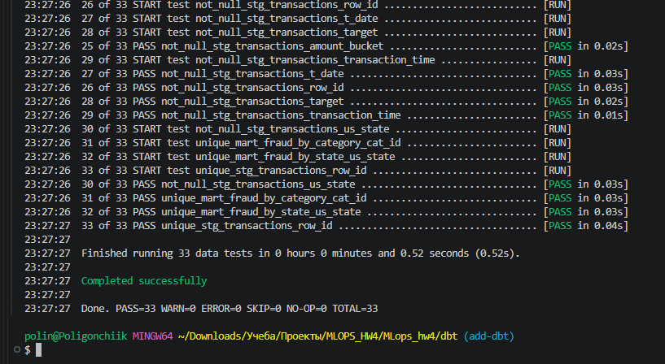
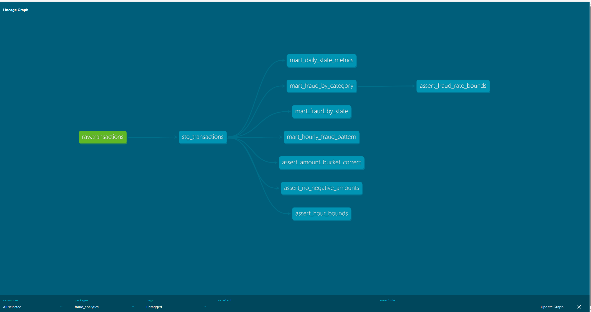

# ДЗ4

Проект dbt на основе ДЗ2.

## Подготовка данных

Скачать `train.csv` из соревнования:

https://www.kaggle.com/t/1918f3f6435300327d38d6c596f97394

Положить файл в `data/train.csv`.

## Запуск

Выполнить из корня проекта `docker compose up -d --build` и подождать


Установить:

```bash
python -m pip install dbt-core==1.10.23 dbt-clickhouse==1.10.3

---
cd dbt
dbt deps --profiles-dir .
dbt build --profiles-dir .
```
## Модели

- `stg_transactions` очистка и нормализация сырых данных.
- `mart_daily_state_metrics` дневные метрики по штатам.
- `mart_fraud_by_category` анализ фрода по категориям.
- `mart_fraud_by_state` географический анализ фрода.
- `mart_hourly_fraud_pattern` временные паттерны фрода.

Макрос `amount_bucket` сегментация сумм: SMALL (меньше 50), MEDIUM (от 50 до 200), LARGE (больше 200).


## Пакеты и тесты

Используются `dbt_utils`, `dbt_date` и `dbt_expectations`. В YAML заданы описания моделей и колонок, проверки `not_null`, `unique`, `accepted_values`, уникальности составных ключей и допустимых диапазонов.

Тесты:

- `assert_no_negative_amounts` отсутствие отрицательных сумм.
- `assert_fraud_rate_bounds` fraud_rate находится от 0 до 100 (%).
- `assert_amount_bucket_correct` группа суммы соответствует её значению.
- `assert_hour_bounds` час находится от 0 до 23.

Запуск тестов:

```bash
dbt test --profiles-dir .
```



## Документация

Генерация и запуск из каталога `dbt`:

```bash
dbt docs generate --profiles-dir .
python -m http.server 8081 --bind 127.0.0.1 --directory target
```

Документация доступна по адресу http://127.0.0.1:8081.



## Версии

- dbt-core: 1.10.23
- dbt-clickhouse: 1.10.3
